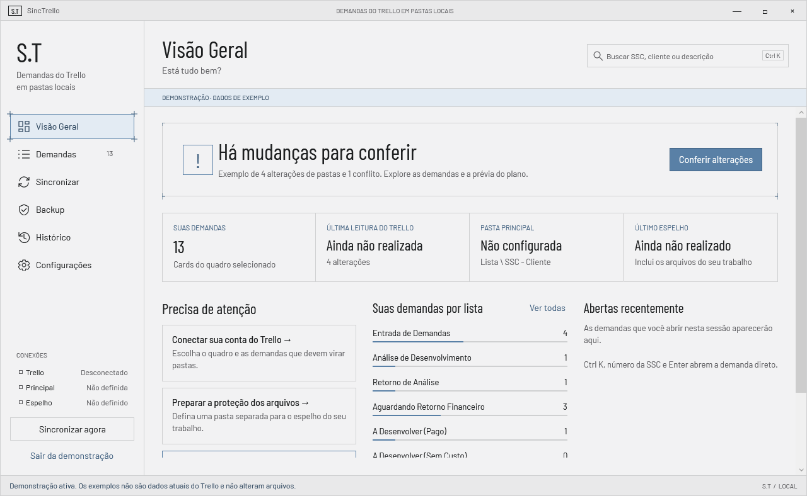
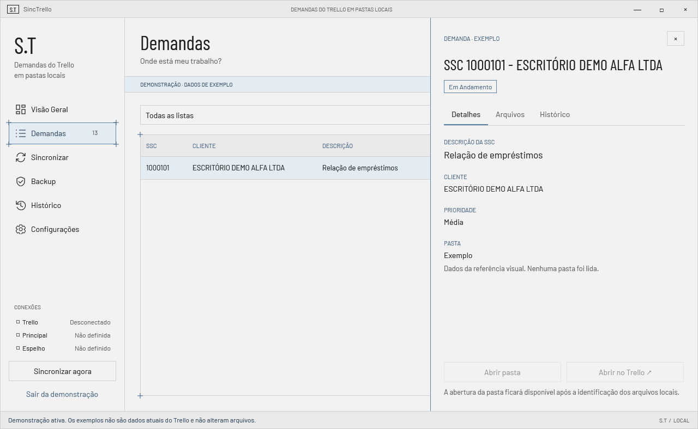
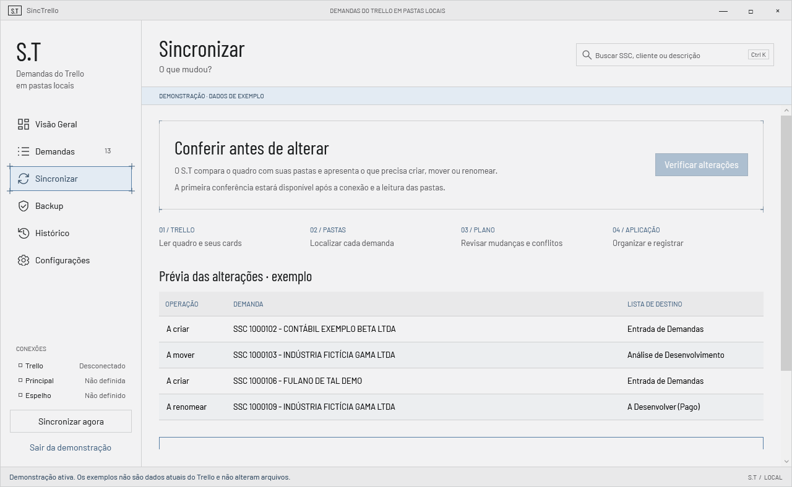

# SincTrello — S.T

Aplicativo Windows que espelha as demandas de um quadro do Trello em pastas locais organizadas, com prévia de cada alteração antes de aplicar e sem nunca escrever no Trello.

<p>
  
  
  
  
  
  
</p>

> **Dados de demonstração fictícios.** Clientes, números de chamado (SSC) e cards exibidos no modo demonstração, nos testes e nas capturas são inventados ("ESCRITÓRIO DEMO ALFA LTDA", "SSC 1000101"). Nenhuma conta, quadro ou credencial real faz parte deste repositório.

## O problema

Em equipes de desenvolvimento sob demanda, cada pedido do cliente vira um card no Trello e uma pasta no disco, com SQL, planilhas e relatórios. O card muda de lista, o nome do cliente é corrigido, a demanda é concluída, e a pasta fica para trás, com o nome antigo e no lugar errado.

Com dezenas de demandas abertas, ninguém sabe ao certo onde está o trabalho de cada uma. Mover e renomear pastas à mão é lento e arriscado: um movimento errado esconde arquivos de um cliente dentro da pasta de outro, e não há registro do que foi feito.

O S.T usa o Trello como fonte oficial da verdade, compara o quadro com as pastas locais e mostra exatamente o que precisa ser criado, movido ou renomeado, aplicando só depois da sua confirmação e mantendo um espelho de proteção em outro disco.

## O que faz

- **Integração de leitura com o Trello** (API key + token autorizado no navegador), com credencial guardada no Gerenciador de Credenciais do Windows.
- **Demandas** do quadro filtradas pelos cards em que a conta é membro, com busca sem acento, filtros por lista e por estado da pasta.
- **Planejamento estrutural por delta:** compara quadro × pastas e gera a prévia de criar, mover e renomear, bloqueando a aplicação em caso de conflito.
- **Espelho de proteção** em outro disco e histórico das operações.
- **Modo demonstração** com dados fictícios, separado dos dados lidos.
- Nunca escreve no Trello e nunca exclui arquivos automaticamente.

Situação atual: leitura do Trello, interface completa e planejamento prontos; scanner de pastas, execução das sincronizações, downloads e backups em desenvolvimento ([roadmap](docs/ROADMAP.md)).

## Capturas

| Visão geral (demo) | Detalhes da demanda | Sincronizar |
| --- | --- | --- |
|  |  |  |

Fluxo de conexão com o Trello (respostas HTTP controladas, conta fictícia): [docs/previews/trello-flow-test](docs/previews/trello-flow-test).

## Stack

C# · .NET 10 (`net10.0-windows`) · WPF · Microsoft.Extensions (DI e Logging) · SQLite (Microsoft.Data.Sqlite) · xUnit · API REST do Trello.

## Como executar

Requisitos: Windows 10/11 e SDK do .NET 10 (ou um SDK local em `.tools/dotnet`, ignorado pelo git).

```powershell
powershell -ExecutionPolicy Bypass -File scripts/verify.ps1   # build + testes
powershell -ExecutionPolicy Bypass -File scripts/run.ps1      # executa o aplicativo
```

A primeira restauração requer acesso ao NuGet. O banco local fica em `%LOCALAPPDATA%/SincTrello/sinctrello.db`. Para conectar: **Configurações → Conectar / trocar conta**, informe a API key, autorize a leitura no navegador, cole o token, escolha o quadro e clique em **Carregar demandas** ([passo a passo](docs/TRELLO_INTEGRATION.md)).

Documentação: [arquitetura](docs/ARCHITECTURE.md) · [decisões](docs/DECISIONS.md) · [regras de sincronização](docs/SYNC_RULES.md) · [regras de armazenamento](docs/STORAGE_RULES.md) · [segurança](docs/SECURITY.md) · [visual e próximos passos](docs/VISUAL_AND_NEXT_STEPS.md).

## Escopo da versão pública

- Código-fonte completo, testes (67) e documentação técnica.
- Dados de demonstração, testes e capturas usam clientes e números de chamado **fictícios**; as capturas foram regeneradas a partir do próprio aplicativo.
- Não acompanham o repositório: protótipo visual interno, prompts de desenvolvimento, registros de trabalho, SDK local e qualquer banco ou credencial.

## Licença

[MIT](LICENSE)

---

Desenvolvido por **Estevão Santos** · **TSCBr — Technology Solution Company** · [tscbr.com.br](https://www.tscbr.com.br/)
